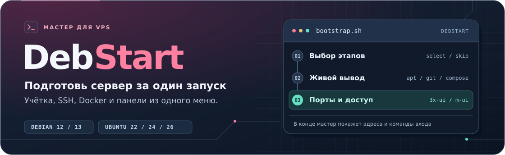

<div align="center">
  
</div>

<p align="center">
  <a href="#быстрый-старт"></a>
  <a href="#быстрый-старт"></a>
  <a href="#как-проходит-установка"></a>
  <a href="#компоненты"></a>
</p>

<p align="center">
  <strong>Интерактивная настройка сервера на Debian и Ubuntu</strong><br>
  <a href="#быстрый-старт">Быстрый старт</a> ·
  <a href="docs/first-run.md">Инструкция для первого VPS</a> ·
  <a href="#компоненты">Компоненты</a> ·
  <a href="#структура-проекта">Структура проекта</a>
</p>

## Быстрый старт

Подключись к серверу по SSH и выполняй команды в открывшемся окне сервера. Если делаешь это впервые, начни с [пошаговой инструкции](docs/first-run.md).

### Если вошёл как `root`

```bash
git clone https://github.com/dfyzicka/DebStart.git
cd DebStart
bash bootstrap.sh
```

<details>
<summary><strong>Если вошёл под пользователем с правами sudo</strong></summary>

```bash
git clone https://github.com/dfyzicka/DebStart.git
cd DebStart
sudo bash bootstrap.sh
```

</details>

Для запуска из ZIP используй [раздел про архив](docs/first-run.md#02-загрузи-архив-и-запусти-мастер).

**Поддержка** · Debian 12 и 13, Ubuntu 22.04, 24.04 и 26.04 LTS. Нужен systemd. Архитектуры amd64 и arm64. Модуль m-ui в Docker доступен на amd64.

Для этапов SSH нужны работающий OpenSSH и `iproute2`. Для пользователя с правами администратора нужен `sudo`.

## Как проходит установка

| Шаг | Действие |
| --- | --- |
| **1 · Пароль root** | Введи новый пароль дважды. |
| **2 · Пользователь и SSH** | Создание учётки с `sudo` и правила SSH выбираются отдельно. При настройке доступа в `/etc/ssh/sshd_config` SSH разрешается выбранному пользователю, прямой вход root запрещается. |
| **3 · Имя хоста** | Введи имя, например `server`. |
| **4 · Порт SSH** | Укажи новый порт, например `2233`. Мастер найдёт текущий порт, применит настройки и сам проверит новый слушатель. |
| **5 · Компоненты** | Выбери пакеты, Oh My Zsh и скины, Python, Docker или панели. Вывод установки идёт в терминал и журнал. |

В начале отметь нужные этапы. Все пункты изначально выключены. В меню `dialog` Пробел ставит галочку, Enter запускает выбранное. В текстовой рамке введи номера через пробел. Для панелей нужен работающий Docker с Compose.

### Способ входа по SSH

| Выбор | Что подготовить |
| --- | --- |
| **Свой ключ** | Вставь содержимое публичного файла `.pub`. |
| **Новый Ed25519** | Задай парольную фразу. Скачай ключ командой SCP через текущий вход, затем подтверди скачивание в мастере. Удали временную копию после проверки нового входа. |
| **Пароль** | Мастер включит вход с действующим паролем выбранной учётки. Пароль можно задать на этапе **Пользователь и sudo**. |

Пароль Linux новой учётки также понадобится для `sudo`. Скачанный приватный ключ храни в своём профиле. На Linux и macOS выставь ему права `chmod 600`.

### Как сменить порт SSH

Выбери **Порт SSH** и укажи новый порт. Мастер перезапустит нужный юнит, проверит ответ OpenSSH на сервере и закроет старый слушатель. При ошибке порт восстанавливается автоматически. Для доступа с компьютера открой новый TCP-порт в правилах хостинга, если там включена фильтрация.

Основные правила и порт записываются в `/etc/ssh/sshd_config`. Первый исходный файл сохраняется как `/etc/ssh/sshd_config.before-debstart`. Мастер поддерживает `ssh.service` и `ssh.socket`. При конфликте с подключаемыми правилами он покажет причину и восстановит настройку текущего шага.

## Компоненты

| Компонент | Для чего | Где смотреть |
| --- | --- | --- |
| **3x-ui** | Панель Xray. | `/opt/3x-ui`, SSH-туннель, порт от 2053. |
| **m-ui** | Панель Mihomo для Mieru и Sudoku. | `/opt/m-ui`, SSH-туннель, порт от 2054. |
| **dry** | Управление контейнерами в терминале. | Запуск командой `sudo dry`. |

Мастер показывает фактические порты. Сохрани данные панели и нажми Enter. Затем запусти показанный SSH-туннель на компьютере и открой полный URL. До подтверждения реквизиты доступны root в `install.state` соответствующей панели.

3x-ui использует образ `ghcr.io/mhsanaei/3x-ui:v3.11.0`. m-ui собирается через Docker из исходников RomanovCaesar. Для Mieru или Sudoku добавь вход нужного типа в разделе **Inbounds** и разреши клиентский порт в firewall и security group VPS.

<details>
<summary><strong>Пакеты APT и версии утилит</strong></summary>

| Система | Список файлов, алиас `sl` | Сведения о системе | Справка `tldr` |
| --- | --- | --- | --- |
| Debian 12 | `exa` | `neofetch` | `tealdeer` |
| Ubuntu 22.04 | `exa` | `neofetch` | `tldr` |
| Ubuntu 24.04 | `eza` | `neofetch` | `tealdeer` |
| Debian 13 и Ubuntu 26.04 | `eza` | `fastfetch` | `tealdeer` |

Мастер выбирает официальный репозиторий Docker для дистрибутива. На Ubuntu при необходимости включает компонент Universe. Ubuntu 22.04 использует `apt`, для остальных поддерживаемых выпусков ставится также `nala`. Интеграция fzf с Zsh использует `fzf --zsh` или скрипты из пакета APT.

`python3-full` и `python3-pip` ставятся из репозитория системы. Python 3.15.2 ставится через `uv` в профиль пользователя. В Zsh команда `python3 --version` покажет 3.15.2, а `/usr/bin/python3` запускает системный интерпретатор.

Мастер скачивает dry v0.13.0 для архитектуры сервера, сверяет SHA-256 с метаданными релиза и устанавливает бинарник в `/usr/local/bin`.

</details>

## Структура проекта

| Путь | Содержимое |
| --- | --- |
| [`bootstrap.sh`](bootstrap.sh) | Запуск мастера из корня. |
| [`installer/lib/`](installer/lib/) | Настройка системы, SSH, Docker и панелей. |
| [`installer/compose/`](installer/compose/) | Шаблоны Compose. |
| [`installer/profile/`](installer/profile/) | Настройки Zsh и Nano, тема и скины MC. |
| [`docs/`](docs/) | Руководство и графика README. |
| [`tests/`](tests/) | Локальные проверки. |
| [`.github/workflows/`](.github/workflows/) | Проверки в GitHub Actions. |
| [`licenses/`](licenses/) | Лицензии сторонних тем. |

## Диагностика

Журнал установки находится в `/var/log/debian-start.log`. Если мастер остановился, проверь последний этап и после устранения причины запусти его снова. Повторный запуск переиспользует каталоги данных панелей и настроенный профиль оболочки. Чтобы увидеть Oh My Zsh после установки, открой новый сеанс под выбранным пользователем или выполни `exec zsh -l` в его текущем сеансе.

```bash
sudo tail -n 50 /var/log/debian-start.log
```

Для проверки контейнера перейди в каталог выбранной панели. Ниже пример для 3x-ui.

```bash
cd /opt/3x-ui
sudo docker compose --env-file compose.env ps
sudo docker compose --env-file compose.env logs --tail=50
```

Под `root` выполняй эти команды без `sudo`. Мастеру нужен доступ к APT, GitHub, PyPI и реестрам Docker.

## Проверки и оформление

Запусти `bash tests/check.sh`, чтобы проверить выбор этапов, ввод пароля, живой вывод и карточки доступа. GitHub Actions проверяет файлы Compose и зависимости APT для всех поддерживаемых выпусков.

- Конфигурация приглашения основана на Powerlevel10k. [Проект](https://github.com/romkatv/powerlevel10k)
- Dracula и Dracula256 для Midnight Commander входят в проект. [Темы](https://draculatheme.com/midnight-commander)
- Скин Ajnasz Blue скачивается при настройке профиля. [Страница автора](https://ajnasz.hu/blog/20140228/midnight-commander-skin)

Для значков Powerlevel10k выбери Nerd Font в настройках терминала на компьютере.
